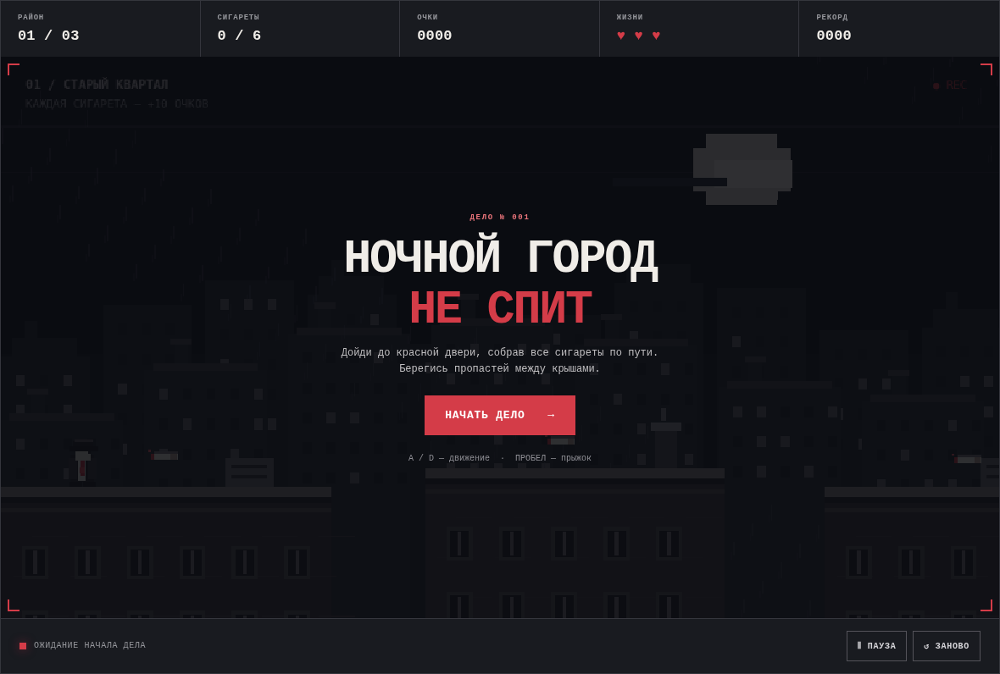
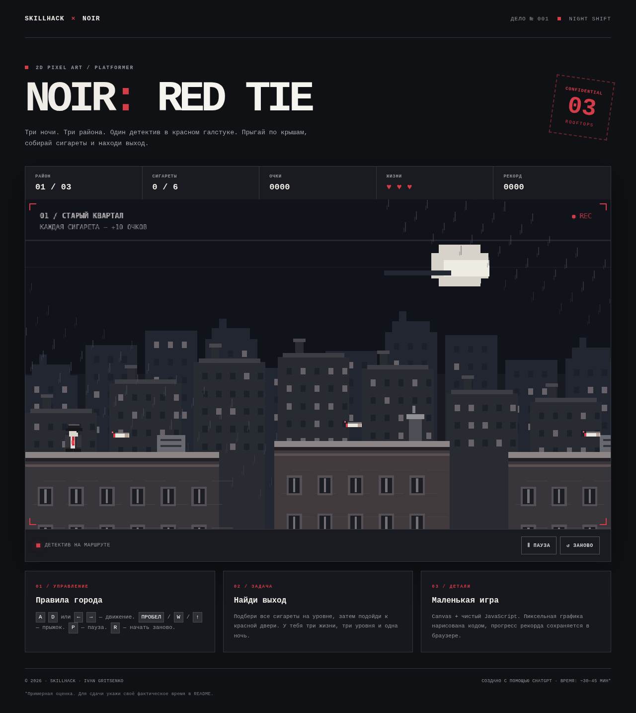

# NOIR: RED TIE

Небольшая браузерная игра-платформер в стиле **2D pixel art noir**.
Главный герой — детектив в шляпе, длинном плаще и красном галстуке. Он бегает и прыгает по крышам ночного города, собирает сигареты и ищет красную дверь — выход из района.

Автор учебного проекта: **Иван Гриценко (SKILLHACK)**.

## Скриншоты игры

**Стартовый экран:**

**Игровой процесс:**

## Что реализовано

- **3 уровня:** старый квартал, промышленная зона, центр города.
- Управление персонажем: движение и прыжки.
- Физика: гравитация и столкновения с платформами.
- Плавная анимация ходьбы персонажа.
- **Сбор сигарет:** +10 очков за каждую.
- **Завершение уровня:** соберите все предметы и доберитесь до красной двери (+50 очков).
- **Три жизни:** падение между крышами отнимает одну жизнь и перезапускает текущий район.
- Меню старта, пауза, рестарт, победа и проигрыш.
- Рекорд сохраняется в `localStorage` браузера.
- Пиксельные город, дождь, небо, крыши и детектив нарисованы программно через Canvas.
- Кнопки для сенсорного управления и адаптивная страница.

## Управление

Идти влево - A или ← 
Идти вправо - D или → 
Прыжок - Пробел, W или ↑ 
Пауза - P или кнопка (пауза)
Новая игра - R или кнопка (заново)

На телефоне используются стрелки, а прышок ПРЫЖОК нажатием под игровым полем.

## Как запустить

Скачать все файлыв одну папку, откройте `index.html` двойным нажатием.

Откройте по ссылке: 

Если удобно использовать VS Code, можно открыть папку проекта и запустить `index.html` через расширение Live Server.

## Использование нейросети

- **Нейросеть:** ChatGPT (GPT-6, OpenAI).
- **Время выполнения:** примерно **30–45 минут**